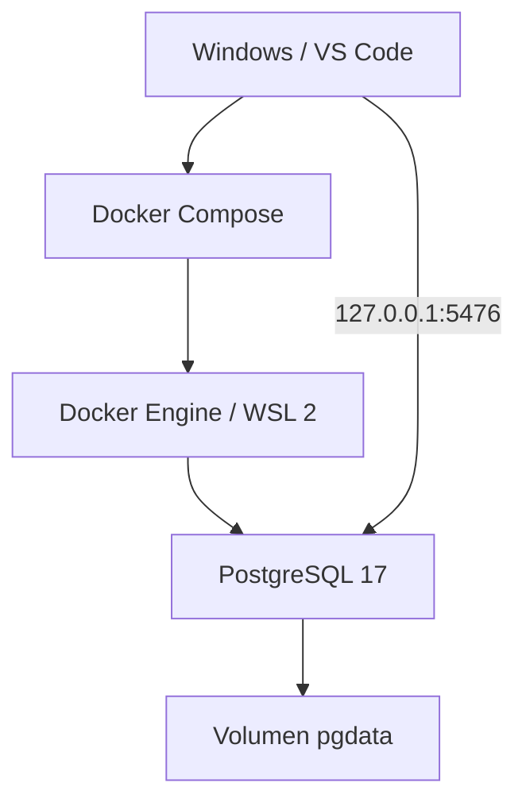
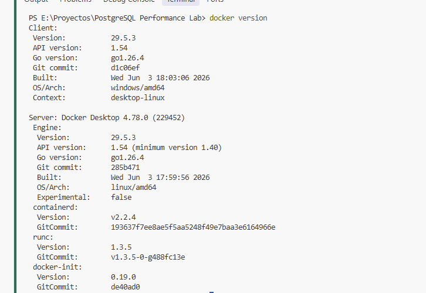
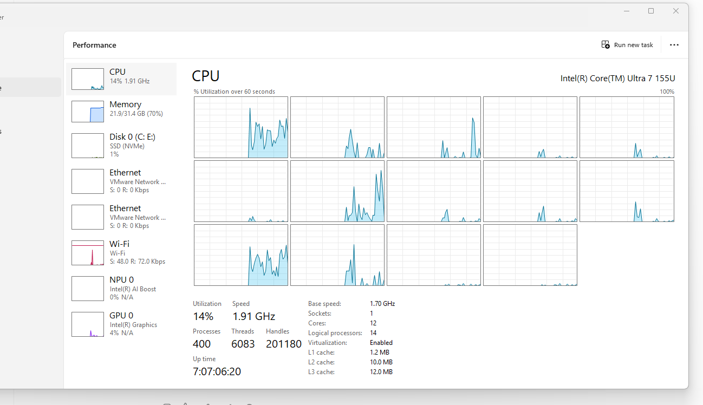
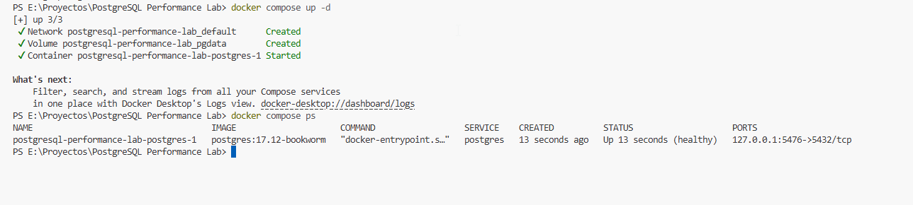
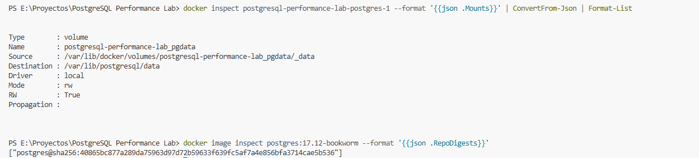

# 00 — Ambiente reproducible

**Estado:** 🟨 En curso — 2 de 4 laboratorios completados.

## Objetivo y alcance

Implementar PostgreSQL 17 aislado, persistente y reproducible mediante Docker Compose, verificar conexión y configuración y cargar datos sintéticos. No se realizan optimizaciones todavía. Prerrequisitos: Windows, VS Code, Docker Desktop, Compose y repositorio Git.

| Laboratorio | Estado | Duración orientativa |
|---|---|---|
| 00.1 Inventario y caracterización | ✅ Completado | 15–25 min |
| 00.2 Implementación con Compose | ✅ Completado | 25–40 min |
| 00.3 Conectividad y configuración | ⬜ Pendiente | 20–30 min |
| 00.4 Datos sintéticos y reproducibilidad | ⬜ Pendiente | 30–45 min |

## Arquitectura



El puerto interno es 5432. La conexión autenticada desde Windows y la persistencia efectiva todavía deben probarse.

## 00.1 — Inventario y caracterización

**Estado:** ✅ Completado.

**Objetivo:** establecer la capacidad inicial del entorno sin modificar recursos. Hipótesis: los recursos disponibles para Docker no necesariamente coinciden con los físicos.

### Paso 1. Docker Engine

Ejecutar `docker version`. Se observó cliente y servidor 29.5.3, API 1.54, cliente Windows y servidor Linux amd64.

**Evidencia 00-01 — Versiones y arquitectura del motor.** Captura obtenida durante el paso descrito.



### Paso 2. Docker Compose

Ejecutar `docker compose version`. Resultado: v5.1.4.

**Evidencia 00-02 — Versión Compose.** Captura obtenida durante el paso descrito.


### Paso 3. Recursos de Docker

Ejecutar `docker info`. Se observaron 14 CPU lógicas, 15,34 GiB de memoria total, arquitectura x86_64 y kernel WSL 2.

**Evidencia 00-03 — CPU, memoria y kernel del entorno Docker.** Captura obtenida durante el paso descrito.


### Paso 4. CPU de Windows

Administrador de tareas → Rendimiento → CPU. Intel Core Ultra 7 155U, 12 núcleos, 14 procesadores lógicos, virtualización habilitada.

**Evidencia 00-04 — CPU del anfitrión.** Captura obtenida durante el paso descrito.



### Paso 5. Memoria de Windows

Administrador de tareas → Rendimiento → Memoria. 32 GB instalados, 31,4 GB utilizables, LPDDR5 a 6400 MT/s. Uso puntual de 21,8 GB (69 %).

**Evidencia 00-05 — Memoria instalada y uso puntual.** Captura obtenida durante el paso descrito.


### Validación y aprendizajes

La capacidad observada del entorno Docker es aproximadamente 49 % de la memoria utilizable de Windows (15,34 / 31,4 × 100, usando unidades binarias). Liberar procesos no incrementa la capacidad del entorno; las CPU no son exclusivas de PostgreSQL. Se reforzó la distinción entre capacidad y disponibilidad. Se acordó conservar los recursos actuales y ampliar únicamente ante necesidad demostrada. No se midió rendimiento del motor ni se verificó aún su capacidad para todas las cargas futuras.

## 00.2 — Implementación de PostgreSQL con Docker Compose

**Estado:** ✅ Completado.

**Objetivo:** desplegar el servicio, verificar su estado y montaje persistente. Hipótesis: Compose creará los recursos y PostgreSQL alcanzará estado saludable. No se realizan pruebas destructivas.

### Paso 1. Prevalidación

```powershell
Get-NetTCPConnection -LocalPort 5476 -State Listen -ErrorAction SilentlyContinue
docker ps -a
docker system df
Get-PSDrive -PSProvider FileSystem
```

No se detectó escucha TCP en 5476; había ocho contenedores, ninguno activo. Se conservaron los recursos de otros proyectos. El espacio libre del anfitrión permitió iniciar el despliegue; no demuestra capacidad interna del disco virtual Docker.

**Evidencia 00-06 — Puerto, contenedores y almacenamiento antes del despliegue.** Captura obtenida durante el paso descrito.


### Paso 2. Configuración

Ver [compose.yaml](../compose.yaml) y [.env.example](../.env.example). Imagen `postgres:17.12-bookworm`, servicio `postgres`, base `performance_lab`, usuario inicial `postgres`, puerto `127.0.0.1:5476:5432`, volumen `pgdata`, `shm_size: 256mb`, healthcheck `pg_isready`. Sin límites adicionales de CPU/RAM. La contraseña local se define en `.env`, excluido de Git por `.gitignore`. No publicar ni capturar su contenido.

```powershell
docker compose config --quiet
if ($LASTEXITCODE -eq 0) { Write-Host "Configuracion Compose valida" }
git check-ignore .env
```

Resultado: configuración válida y `.env` excluido. El archivo publicado coincide con el diseño aprobado.

**Evidencia 00-07 — Validación Compose y exclusión de .env.** Captura obtenida durante el paso descrito.


### Paso 3. Despliegue

```powershell
docker compose pull
docker compose up -d
docker compose ps
```

Se creó la red `postgresql-performance-lab_default`, el volumen `postgresql-performance-lab_pgdata` y el contenedor `postgresql-performance-lab-postgres-1`. Puerto publicado según diseño.

**Evidencia 00-08 — Recursos creados y estado healthy.** Captura obtenida durante el paso descrito.



### Paso 4. Healthcheck

Estado observado: `Up (healthy)`, registrado en la misma captura del despliegue. No se requiere una captura adicional. Este estado no demuestra autenticación ni ejecución de consultas.

### Paso 5. Volumen y digest

```powershell
docker inspect postgresql-performance-lab-postgres-1 --format '{{json .Mounts}}' | ConvertFrom-Json | Format-List
docker image inspect postgres:17.12-bookworm --format '{{json .RepoDigests}}'
```

Montaje de tipo volume, driver local, lectura/escritura, destino `/var/lib/postgresql/data`. Se registró el digest SHA-256 en la captura. El digest identifica contenido del manifiesto o índice; una etiqueta puede cambiar de contenido. Se conserva la etiqueta en Compose por decisión inicial; el digest registrado permite identificar la imagen original, sujeto a disponibilidad y plataforma.

**Evidencia 00-09 — Montaje y digest registrados.** Captura obtenida durante el paso descrito.



### Validación y aprendizajes

Se verificó despliegue saludable, publicación del puerto y montaje. El estudiante explicó que eliminar solo el contenedor no elimina el volumen y que un digest distinto indica cambio de contenido de imagen. La persistencia efectiva se probará en 00.4; la conexión y versión SQL en 00.3. No hubo errores de despliegue reportados. No ejecutar `docker compose down -v` para conservar datos; la detención mediante `docker compose stop` es reversible.

## Referencias

- [Docker system info](https://docs.docker.com/reference/cli/docker/system/info/)
- [Docker Desktop settings](https://docs.docker.com/desktop/settings-and-maintenance/settings/)
- [Imagen oficial PostgreSQL](https://hub.docker.com/_/postgres)
- [Compose services](https://docs.docker.com/reference/compose-file/services/)
- [Docker volumes](https://docs.docker.com/engine/storage/volumes/)
- [Image digests](https://docs.docker.com/dhi/core-concepts/digests/)
- [PostgreSQL 17](https://www.postgresql.org/docs/17/)
