# 00 - Ambiente reproducible

**Estado:** ✅ Completado - 4 de 4 laboratorios validados (19-11-2026).

## Objetivo y alcance

Implementar PostgreSQL 17 aislado, persistente y reproducible mediante Docker Compose, verificar conexión y configuración y cargar datos sintéticos. No se realizan optimizaciones todavía. Prerrequisitos: Windows, VS Code, Docker Desktop, Compose y repositorio Git.

| Laboratorio | Estado | Duración orientativa |
|---|---|---|
| 00.1 Inventario y caracterización | ✅ Completado | 15–25 min |
| 00.2 Implementación con Compose | ✅ Completado | 25–40 min |
| 00.3 Conectividad y configuración | ✅ Completado | 20–30 min |
| 00.4 Datos sintéticos y reproducibilidad | ✅ Completado | 30–45 min |

## Arquitectura

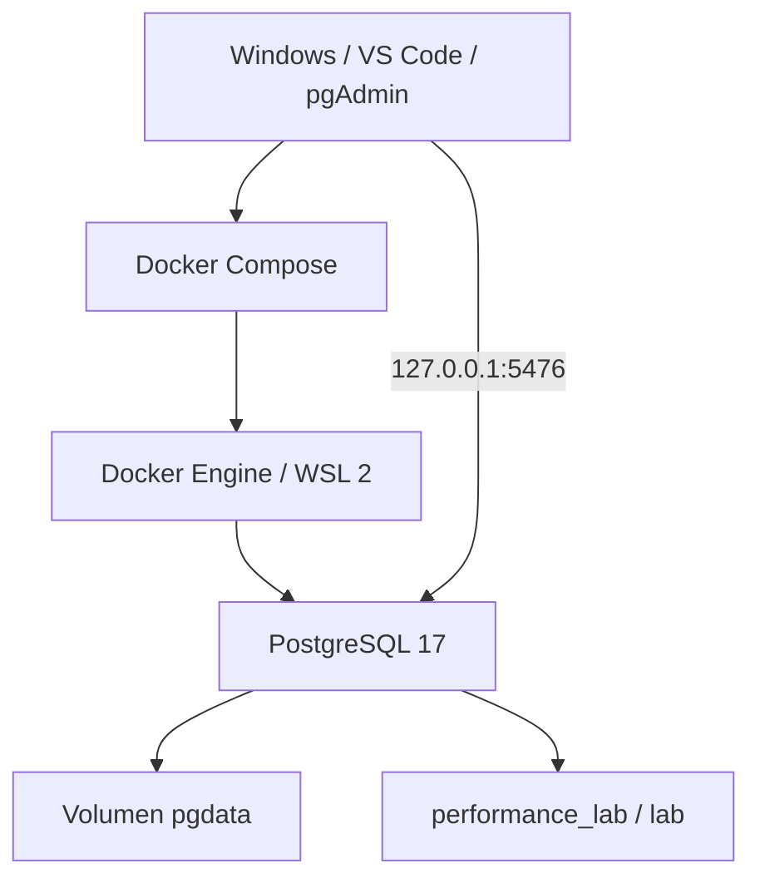

El puerto interno es 5432. La conexión autenticada desde Windows y la persistencia efectiva fueron verificadas.

## 00.1 - Inventario y caracterización

**Estado:** ✅ Completado.

**Objetivo:** establecer la capacidad inicial del entorno sin modificar recursos. Hipótesis: los recursos disponibles para Docker no necesariamente coinciden con los físicos.

### Paso 1. Docker Engine

Ejecutar `docker version`. Se observó cliente y servidor 29.5.3, API 1.54, cliente Windows y servidor Linux amd64.

**Evidencia 00-01 - Versiones y arquitectura del motor**


### Paso 2. Docker Compose

Ejecutar `docker compose version`. Resultado: v5.1.4.

**Evidencia 00-02 - Versión Compose**


### Paso 3. Recursos de Docker

Ejecutar `docker info`. Se observaron 14 CPU lógicas, 15,34 GiB de memoria total, arquitectura x86_64 y kernel WSL 2.

**Evidencia 00-03 - CPU, memoria y kernel del entorno Docker**

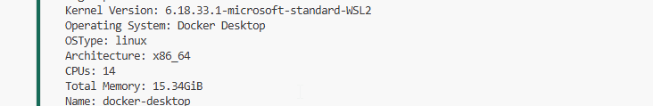

### Paso 4. CPU de Windows

Administrador de tareas → Rendimiento → CPU. Intel Core Ultra 7 155U, 12 núcleos, 14 procesadores lógicos, virtualización habilitada.

**Evidencia 00-04 - CPU del anfitrión**


### Paso 5. Memoria de Windows

Administrador de tareas → Rendimiento → Memoria. 32 GB instalados, 31,4 GB utilizables, LPDDR5 a 6400 MT/s. Uso puntual de 21,8 GB (69 %).

**Evidencia 00-05 - Memoria instalada y uso puntual**

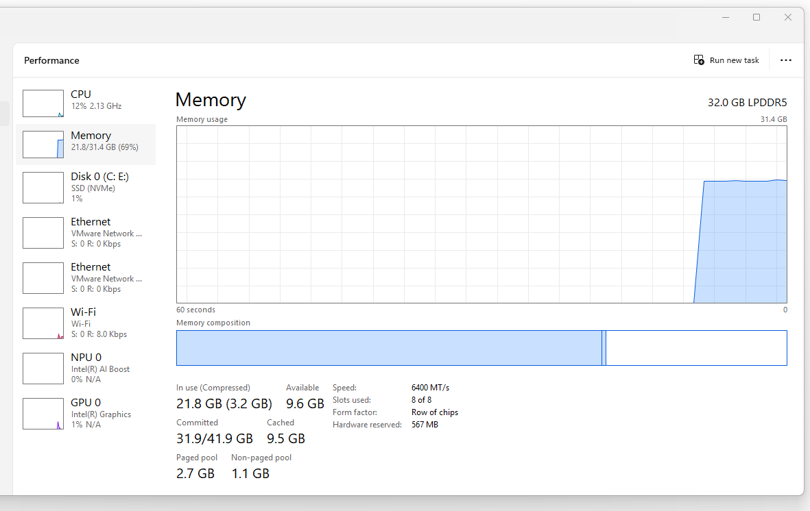

### Validación y aprendizajes

La capacidad observada del entorno Docker es aproximadamente 49 % de la memoria utilizable de Windows (15,34 / 31,4 × 100, usando unidades binarias). Liberar procesos no incrementa la capacidad del entorno; las CPU no son exclusivas de PostgreSQL. Para este entorno se conservan los recursos actuales y ampliar únicamente ante necesidad demostrada. No se midió rendimiento del motor ni se verificó su capacidad para todas las cargas futuras.

## 00.2 - Implementación de PostgreSQL con Docker Compose

**Estado:** ✅ Completado.

**Objetivo:** desplegar el servicio, verificar su estado y montaje persistente. Hipótesis: Compose creará los recursos y PostgreSQL alcanzará estado saludable. No se realizan pruebas destructivas.

### Paso 1. Prevalidación

```powershell
Get-NetTCPConnection -LocalPort 5476 -State Listen -ErrorAction SilentlyContinue
docker ps -a
docker system df
Get-PSDrive -PSProvider FileSystem
```
No se detectó escucha TCP en 5476; había ocho contenedores, ninguno activo. Se conservaron los recursos de otros proyectos. El espacio libre del anfitrión permitió iniciar el despliegue; no demuestra capacidad interna del disco virtual Docker.

**Evidencia 00-06 - Puerto, contenedores y almacenamiento antes del despliegue**

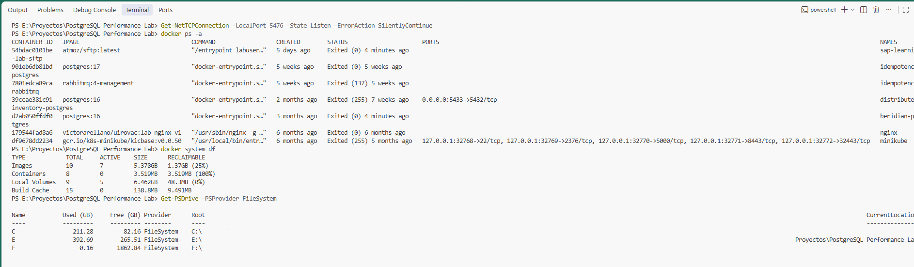

### Paso 2. Configuración

Ver [compose.yaml](../compose.yaml) y [.env.example](../.env.example). Imagen `postgres:17.12-bookworm`, servicio `postgres`, base `performance_lab`, usuario inicial `postgres`, puerto `127.0.0.1:5476:5432`, volumen `pgdata`, `shm_size: 256mb`, healthcheck `pg_isready`. Sin límites adicionales de CPU/RAM. La contraseña local se define en `.env`, excluido de Git por `.gitignore`. No publicar ni capturar su contenido.

```powershell
docker compose config --quiet
if ($LASTEXITCODE -eq 0) { Write-Host "Configuracion Compose valida" }
git check-ignore .env
```
Resultado: configuración válida y `.env` excluido. El archivo publicado coincide con el diseño aprobado.

**Evidencia 00-07 - Validación Compose y exclusión de .env**

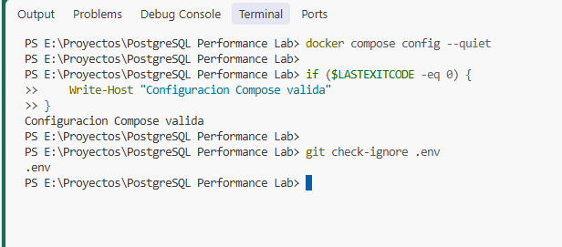

### Paso 3. Despliegue

```powershell
docker compose pull
docker compose up -d
docker compose ps
```
Se creó la red `postgresql-performance-lab_default`, el volumen `postgresql-performance-lab_pgdata` y el contenedor `postgresql-performance-lab-postgres-1`. Puerto publicado según diseño.

**Evidencia 00-08 - Recursos creados y estado healthy**


### Paso 4. Healthcheck

Estado observado: `Up (healthy)`, registrado en la misma captura del despliegue. No se requiere una captura adicional. Este estado no demuestra autenticación ni ejecución de consultas.

### Paso 5. Volumen y digest

```powershell
docker inspect postgresql-performance-lab-postgres-1 --format '{{json .Mounts}}' | ConvertFrom-Json | Format-List
docker image inspect postgres:17.12-bookworm --format '{{json .RepoDigests}}'
```
Montaje de tipo volume, driver local, lectura/escritura, destino `/var/lib/postgresql/data`. Se registró el digest SHA-256 en la captura. El digest identifica contenido del manifiesto o índice; una etiqueta puede cambiar de contenido. Se conserva la etiqueta en Compose por decisión inicial; el digest registrado permite identificar la imagen original, sujeto a disponibilidad y plataforma.

**Evidencia 00-09 - Montaje y digest registrados**


### Validación y aprendizajes

Se verificó despliegue saludable, publicación del puerto y montaje. Eliminar solo el contenedor no elimina por sí mismo el volumen nombrado. Un digest distinto identifica contenido diferente del manifiesto o índice de imagen. No hubo errores de despliegue reportados. No ejecutar `docker compose down -v` para conservar datos; la detención mediante `docker compose stop` es reversible. La persistencia efectiva y la conexión SQL se verificaron en los laboratorios siguientes.

## 00.3 - Conectividad y configuración

**Estado:** ✅ Completado.

Objetivo: verificar conectividad interna y externa, autenticación y línea base de parámetros sin cambiar configuración. Prerrequisito: servicio saludable de 00.2. Hipótesis: la conexión interna por socket y la externa por TCP pueden aplicar reglas diferentes.

### Paso 1. Conexión interna

```powershell
docker compose exec postgres psql -U postgres -d performance_lab
```
```sql
SELECT version(), current_database(), current_user;
```
Resultado: PostgreSQL 17.12 Debian, x86_64, base performance_lab, usuario postgres; cliente psql 17.12. Conexión por socket sin solicitud de contraseña. Salir con `\q`. `Get-Command psql -ErrorAction SilentlyContinue` sin salida en Windows; se eligió pgAdmin, no se concluyó que psql estuviera desinstalado.

**Evidencia 00-10 - Versión SQL y conexión interna**

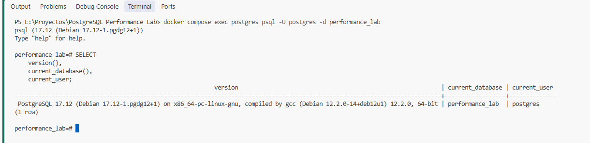

### Paso 2. Configuración externa

pgAdmin, registro LocalContainerPDB: localhost, puerto 5476, base performance_lab, usuario postgres. Contraseña enmascarada; no registrar secretos.

**Evidencia 00-11 - Configuración de pgAdmin**

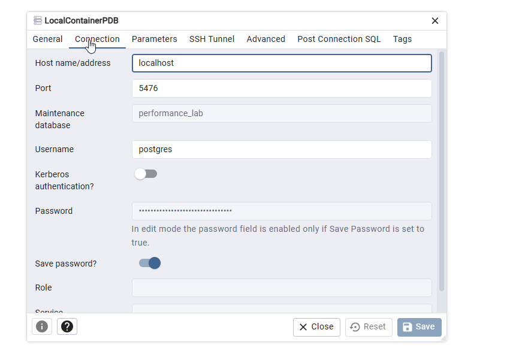

### Paso 3. Identificación de sesión TCP

```sql
SELECT current_database(), current_user, inet_client_addr(),
       inet_client_port(), inet_server_addr(), inet_server_port();
```
Resultado: cliente 172.22.0.1:34992, servidor 172.22.0.2:5432. El puerto publicado 5476 no es el puerto que escucha PostgreSQL dentro del contenedor. Las direcciones y el puerto efímero son observaciones puntuales.

**Evidencia 00-12 - Conexión TCP externa**

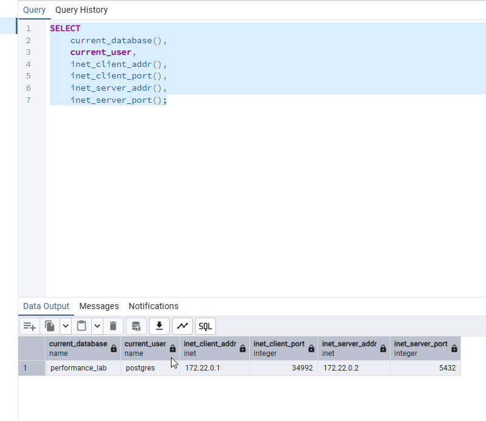

### Paso 4. Reglas de autenticación

```sql
SELECT rule_number,type,database,user_name,address,auth_method,error
FROM pg_hba_file_rules ORDER BY rule_number;
```
Siete reglas sin errores de análisis: local all/all trust; host all/all 127.0.0.1 y ::1 trust; tres reglas equivalentes para replication; host all/all all scram-sha-256. La vista muestra el archivo actual, no garantiza que todas sus reglas estén cargadas. La conexión interna es compatible con la primera regla y la externa con la última.

**Evidencia 00-13 - Reglas HBA observadas**

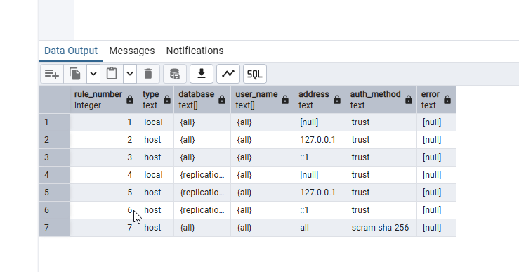

### Paso 5. Prueba negativa

Registrar temporalmente PruebaAutenticacion en pgAdmin, host 127.0.0.1, puerto 5476, base performance_lab, usuario postgres, contraseña incorrecta. Resultado: FATAL: password authentication failed for user "postgres".

**Evidencia 00-14 - Rechazo con contraseña incorrecta**

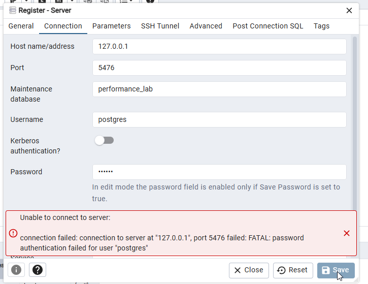

### Paso 6. Prueba positiva

Repetir con contraseña correcta, sin mostrarla. Conexión exitosa. Se indicó eliminar el registro temporal de pgAdmin, no la base; no se verificó esa eliminación.

**Evidencia 00-15 - Conexión autenticada exitosa**

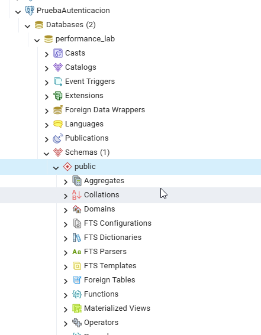

### Paso 7. Línea base de parámetros

```sql
SELECT name,setting,unit,source,context,pending_restart
FROM pg_settings
WHERE name IN ('shared_buffers','effective_cache_size','work_mem',
 'maintenance_work_mem','max_connections','max_worker_processes',
 'max_parallel_workers','max_parallel_workers_per_gather')
ORDER BY name;
```
| Parámetro | Valor efectivo | Contexto |
|---|---|---|
| shared_buffers | 128 MiB | postmaster |
| effective_cache_size | 4 GiB | user |
| work_mem | 4 MiB | user |
| maintenance_work_mem | 64 MiB | user |
| max_connections | 100 | postmaster |
| max_worker_processes | 8 | postmaster |
| max_parallel_workers | 8 | user |
| max_parallel_workers_per_gather | 2 | user |

Todos sin reinicio pendiente. shared_buffers y max_connections proceden del archivo de configuración; restantes del valor predeterminado. shared_buffers equivale a 16384 bloques de 8 KiB; effective_cache_size a 524288 bloques de 8 KiB. No se aplicó ajuste alguno.

**Evidencia 00-16 - Inventario de configuración**

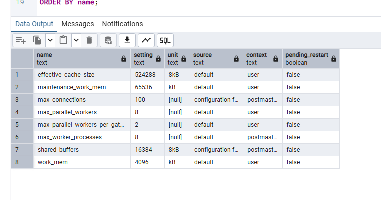

### Validación y aprendizajes

Se comprobó autenticación negativa y positiva, no solo disponibilidad. El puerto publicado y el puerto interno pertenecen a capas distintas. `effective_cache_size` es una estimación para el planner, no memoria reservada. `work_mem` es un límite base por operación, no por conexión; operaciones hash pueden aplicar un multiplicador y el paralelismo puede incrementar consumos. Tres ordenamientos simultáneos de 4 MiB por consulta y 50 consultas implican 600 MiB potenciales, no una reserva garantizada. `SET work_mem` modifica el valor de la sesión (salvo alcance local de transacción); `shared_buffers` requiere reinicio. No se ejecutó ajuste ni se midieron efectos de rendimiento.

## 00.4 - Datos sintéticos y reproducibilidad

**Estado:** ✅ Completado.

Objetivo: construir datos deterministas, registrar distribución, tamaños, estadísticas y comprobar persistencia y regeneración. Prerrequisitos: 00.3 validado, espacio disponible, conexión a performance_lab. Hipótesis: 1.011.000 filas, tres índices primarios, distribución de ventas 90/8/2 y huellas iguales tras recrear y regenerar.

### Paso 1. Escenario inicial

```sql
SELECT current_database() AS database_name,
 pg_size_pretty(pg_database_size(current_database())) AS database_size,
 EXISTS (SELECT 1 FROM pg_namespace WHERE nspname='lab') AS lab_schema_exists;
```
Resultado: performance_lab, 7550 kB, false. Se conserva public y se crea un esquema lógico separado lab.

**Evidencia 00-17 - Base inicial sin esquema lab**

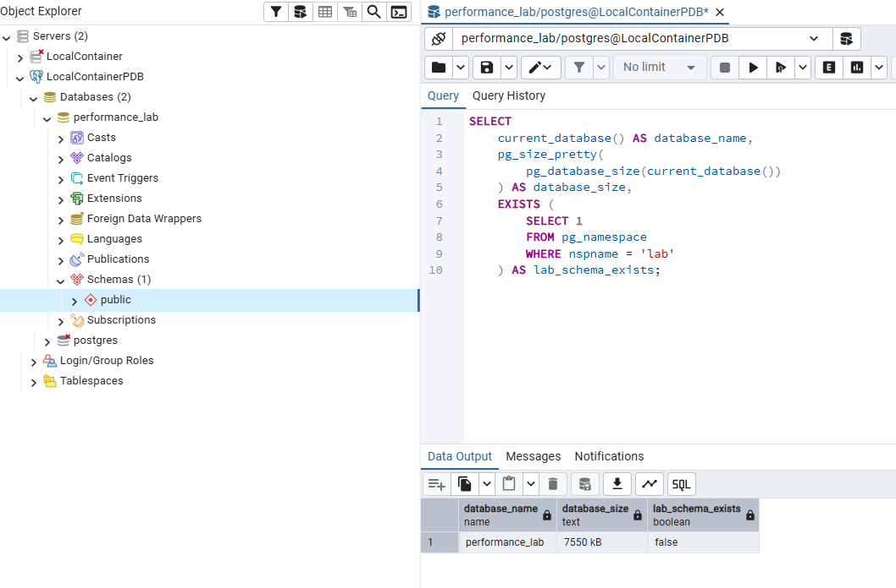

### Paso 1.2. Almacenamiento Docker

`docker compose exec postgres df -h /var/lib/postgresql/data`: /dev/sdd, 1007G total, 14G usado, 942G libre, 2 %. Capacidad virtual, no equivale a espacio físico de Windows.

**Evidencia 00-18 - Espacio disponible en Docker**

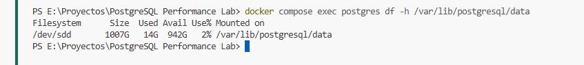

### Paso 2. Modelo relacional

Ejecutar [01-create-schema.sql](../sql/01-create-schema.sql) en performance_lab. Crea lab, customers, products y sales en una transacción. Claves primarias en customer_id, product_id y sale_id; sales referencia ambos catálogos. Restricciones NOT NULL y CHECK de precio, cantidad y estado. La captura prueba existencia de tablas, no salida de ejecución.

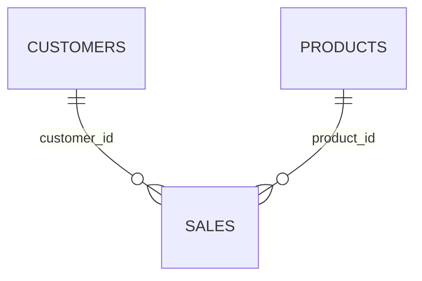

**Evidencia 00-19 - Esquema lab y tres tablas**

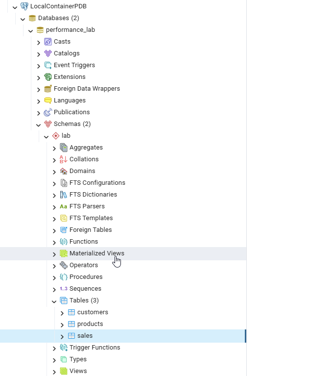

### Paso 2.5. Índices iniciales

```sql
SELECT schemaname,tablename,indexname,indexdef FROM pg_indexes
WHERE schemaname='lab' ORDER BY tablename,indexname;
```
Tres índices únicos B-tree: customers_pkey, products_pkey, sales_pkey. No hay índices secundarios ni índices automáticos en las columnas referenciantes de sales.

**Evidencia 00-20 - Tres índices primarios**

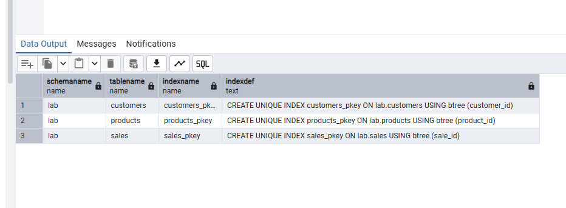

### Paso 3.3. Espacio físico antes de carga

```powershell
Get-PSDrive -PSProvider FileSystem | Select-Object Name,
 @{Name='Used_GiB';Expression={[math]::Round($_.Used / 1GB, 2)}},
 @{Name='Free_GiB';Expression={[math]::Round($_.Free / 1GB, 2)}}
```
Libre: C 82,14; E 265,51; F 1862,84 GiB. No se identificó qué unidad contiene el disco virtual.

**Evidencia 00-21 - Espacio físico antes de cargar**

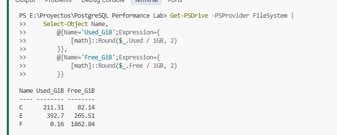

### Paso 3.4. Generación

Ejecutar [02-generate-data.sql](../sql/02-generate-data.sql) sobre tablas vacías. Usa generate_series, aritmética modular, fechas fijas desde 2024-01-01 y CASE para distribuir estados; 5 regiones, 10 categorías. Puede generar correlaciones artificiales. COMMIT exitoso; pgAdmin informó 14,692 segundos en una ejecución, no benchmark.

**Evidencia 00-22 - Carga sintética completada**

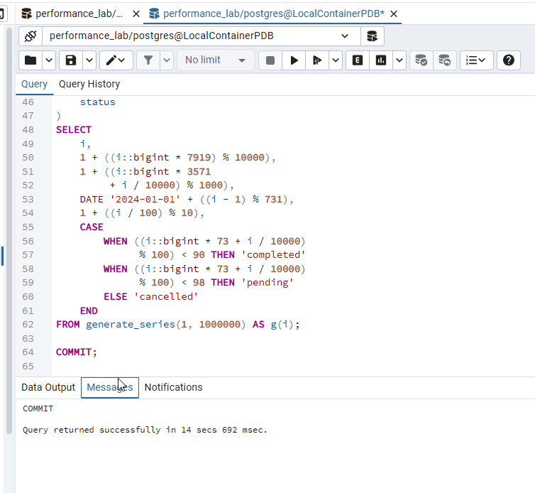

### Paso 4.1. Cardinalidad

Ejecutar bloque 1 de [03-validate-data.sql](../sql/03-validate-data.sql). COUNT(*) devolvió 10.000 clientes, 1.000 productos y 1.000.000 ventas, total 1.011.000.

**Evidencia 00-23 - Cardinalidades exactas**

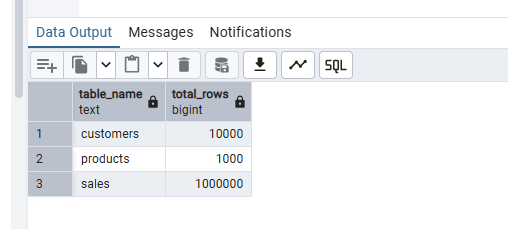

### Paso 4.2. Distribución

Bloque 2: GROUP BY status y porcentaje del total. completed 900.000 (90 %), pending 80.000 (8 %), cancelled 20.000 (2 %). Coincide exactamente con diseño. Hipótesis futura: un índice sobre status podría beneficiar más al filtro cancelled; aún no se ha probado.

**Evidencia 00-24 - Distribución real de estados**

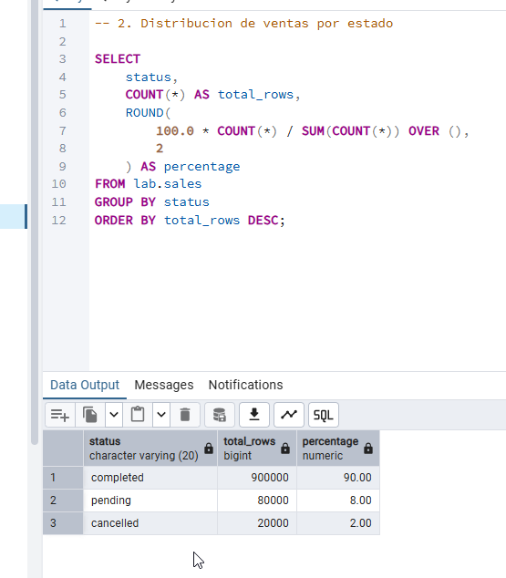

### Paso 4.3. Almacenamiento

Bloque 3: pg_table_size, pg_indexes_size y pg_total_relation_size.

| Tabla | Tabla y auxiliares | Índices | Total |
|---|---:|---:|---:|
| sales | 65 MB | 21 MB | 86 MB |
| customers | 624 kB | 240 kB | 864 kB |
| products | 96 kB | 40 kB | 136 kB |

Valores redondeados de pg_size_pretty (unidades binarias). Índice de sales ≈ 21/86 × 100 = 24,4 % del total. Crear un índice incrementaría indexes_size y total_size.

**Evidencia 00-25 - Línea base de almacenamiento**

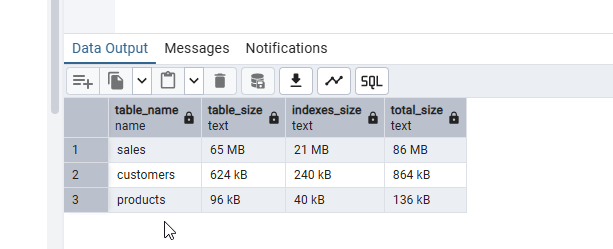

### Paso 4.4. Estadísticas

Bloque 4: ANALYZE de las tres tablas y consulta pg_stat_user_tables. n_live_tup coincidió con los conteos exactos; last_analyze y last_autoanalyze presentes, análisis manual posterior al automático. Las estimaciones no son conteos exactos por definición.

**Evidencia 00-26 - Estadísticas manuales y automáticas**

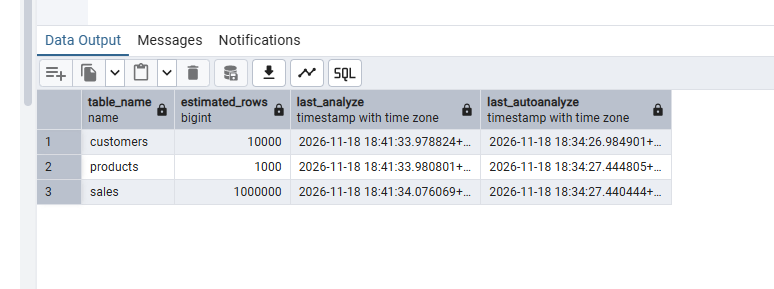

### Paso 4.5. Distribución estimada

Bloque 5: pg_stats para sales.status. null_frac=0, n_distinct=3. Valores frecuentes completed, pending, cancelled; frecuencias 0,9007; 0,07963333; 0,019666666. Multiplicadas por 1.000.000 producen aproximadamente 900.700, 79.633 y 19.667 filas frente a 900.000, 80.000 y 20.000 reales. Diferencias compatibles con muestreo; no son estimaciones extraídas de un plan.

**Evidencia 00-27 - Frecuencias estimadas por ANALYZE**

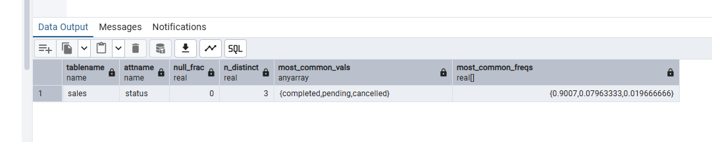

### Paso 5.1. Huellas iniciales

Bloque 6: MD5 de concatenación de MD5 de cada fila convertida a texto, ordenada por clave primaria. Ejecutar bajo la misma representación de datos. Es una comprobación lógica de cambios accidentales, no garantía absoluta ni prueba criptográfica de seguridad.

| Tabla | Filas | MD5 |
|---|---:|---|
| customers | 10000 | `ff462b2cb1dbfcb3dcdaa8927860cd84` |
| products | 1000 | `9d78da177ce8764b13277268978029e8` |
| sales | 1000000 | `e78e72024daf9b8349f05735056d183b` |

**Evidencia 00-28 - Huellas de referencia**

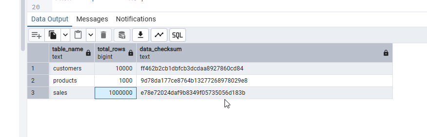

### Paso 5.2. Identificación original

```powershell
docker compose ps
docker inspect (docker compose ps -q postgres) --format 'Container ID: {{.Id}}'
docker inspect (docker compose ps -q postgres) --format '{{range .Mounts}}{{.Name}} -> {{.Destination}}{{println}}{{end}}'
```
ID original c79d44f83bf5…; volumen postgresql-performance-lab_pgdata, destino /var/lib/postgresql/data. La captura contiene las dos inspecciones, no docker compose ps.

**Evidencia 00-29 - Identificador y volumen originales**

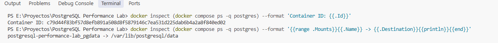

### Paso 5.3. Recreación

Guardar trabajo pendiente (interrumpe conexiones). Ejecutar:
```powershell
docker compose up -d --force-recreate --no-deps --pull never postgres
```
Repetir comandos del paso anterior. Nuevo ID 822501ed6398…, mismo nombre de volumen y destino, Up (healthy). No usar down -v; --pull never evita descargar otra imagen, no prueba igualdad de digest.

**Evidencia 00-30 - Nuevo contenedor saludable**

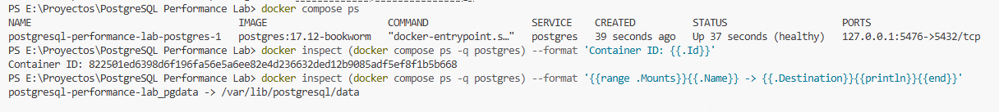

### Paso 5.4. Persistencia

Reconectar a performance_lab y repetir bloque 6. Las tres cardinalidades y huellas coinciden exactamente con la tabla de referencia del paso 5.1.

**Evidencia 00-31 - Contenido conservado tras recreación**

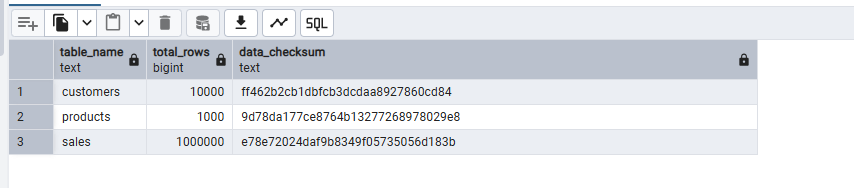

### Paso 5.5. Regeneración

Crear base separada con autocommit, fuera de una transacción:
```sql
CREATE DATABASE performance_lab_repro TEMPLATE template0;
```
Conectar a ella y comprobar `SELECT current_database();`. Ejecutar scripts 01 y 02 sin modificaciones según procedimiento, luego bloque 6 de 03. La captura prueba conexión a performance_lab_repro y coincidencia de los tres conteos y huellas. No prueba instalación nueva, igualdad física o igualdad de estadísticas.

**Evidencia 00-32 - Regeneración lógica en base independiente**

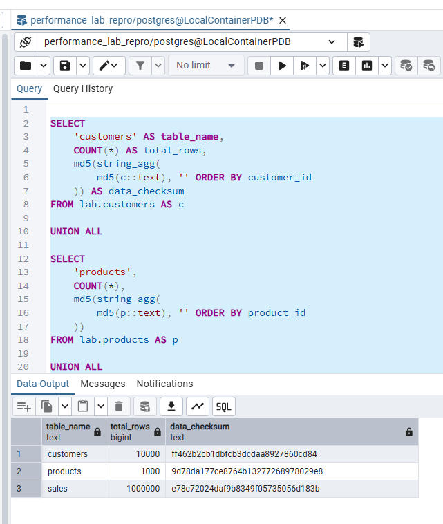

### Paso 5.6. Limpieza

Con autorización, cerrar conexiones a la base temporal y desde performance_lab eliminar únicamente `performance_lab_repro` (destructivo). Ejecutar `DROP DATABASE performance_lab_repro;` fuera de una transacción y verificar:
```sql
SELECT current_database() AS active_database,
 EXISTS (SELECT 1 FROM pg_database WHERE datname='performance_lab_repro') AS temporary_database_exists,
 (SELECT COUNT(*) FROM lab.sales) AS sales_count;
```
Resultado: performance_lab, false, 1000000. La consulta verifica ausencia de la base temporal y conservación de cardinalidad de sales, no vuelve a calcular todas las huellas.

**Evidencia 00-33 - Limpieza y ambiente final**

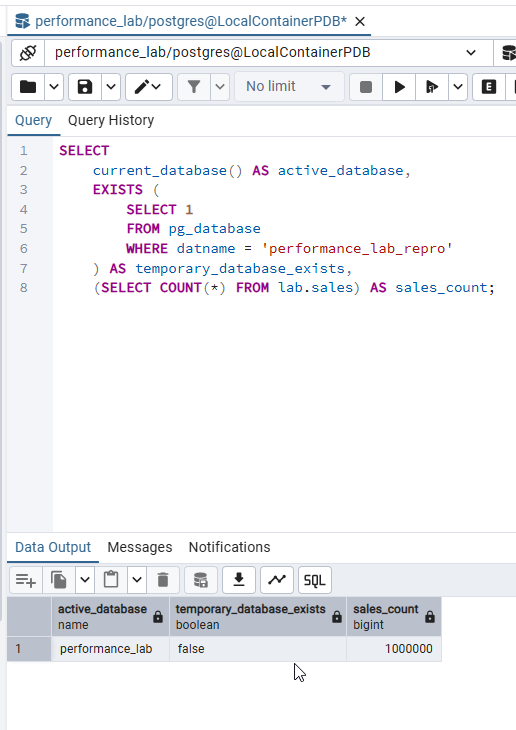

### Validación, problemas y aprendizajes

Todos los criterios técnicos se cumplieron. No se necesitó script destructivo de reinicialización porque se utilizó una base independiente. Las huellas coincidentes respaldan persistencia y reproducibilidad lógica; no garantizan igualdad física, tiempos, caché ni planes. No se han realizado optimizaciones. Las 33 rutas de evidencia y los tres scripts están publicados; las capturas respaldan las observaciones de cada actividad.

## Retrospectiva del proceso

El registro de evaluación metodológica y sus decisiones se conserva por separado en [RETROSPECTIVES.md](RETROSPECTIVES.md).

## Referencias

- [Docker system info](https://docs.docker.com/reference/cli/docker/system/info/)
- [Docker Desktop settings](https://docs.docker.com/desktop/settings-and-maintenance/settings/)
- [Imagen oficial PostgreSQL](https://hub.docker.com/_/postgres)
- [Compose services](https://docs.docker.com/reference/compose-file/services/)
- [Docker volumes](https://docs.docker.com/engine/storage/volumes/)
- [Image digests](https://docs.docker.com/dhi/core-concepts/digests/)
- [Compose up](https://docs.docker.com/reference/cli/docker/compose/up/)
- [PostgreSQL 17](https://www.postgresql.org/docs/17/)
- [HBA](https://www.postgresql.org/docs/17/auth-pg-hba-conf.html)
- [pg_hba_file_rules](https://www.postgresql.org/docs/17/view-pg-hba-file-rules.html)
- [pg_settings](https://www.postgresql.org/docs/17/view-pg-settings.html)
- [Recursos](https://www.postgresql.org/docs/17/runtime-config-resource.html)
- [Planner](https://www.postgresql.org/docs/17/runtime-config-query.html)
- [Esquemas](https://www.postgresql.org/docs/17/ddl-schemas.html)
- [Restricciones](https://www.postgresql.org/docs/17/ddl-constraints.html)
- [pg_indexes](https://www.postgresql.org/docs/17/view-pg-indexes.html)
- [generate_series](https://www.postgresql.org/docs/17/functions-srf.html)
- [Tamaños](https://www.postgresql.org/docs/17/functions-admin.html#FUNCTIONS-ADMIN-DBSIZE)
- [ANALYZE](https://www.postgresql.org/docs/17/sql-analyze.html)
- [pg_stats](https://www.postgresql.org/docs/17/view-pg-stats.html)
- [Monitoring statistics](https://www.postgresql.org/docs/17/monitoring-stats.html)
- [Aggregate functions](https://www.postgresql.org/docs/17/functions-aggregate.html)
- [String functions](https://www.postgresql.org/docs/17/functions-string.html)
- [CREATE DATABASE](https://www.postgresql.org/docs/17/sql-createdatabase.html)
